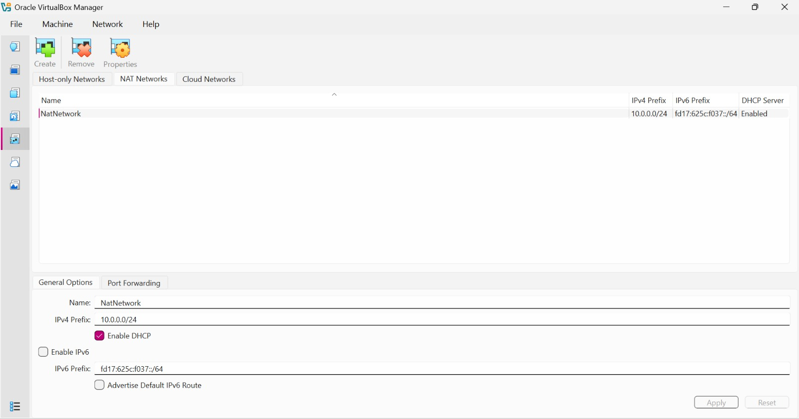

# 🔐 Cybersecurity Lab Environment Setup

**Building an isolated virtual lab for penetration testing and ethical hacking practice**

  
  
  
  
  
  
  
  
  
  

---

## 📌 Project Overview

This project focuses on setting up a **virtual cybersecurity and penetration-testing laboratory** using VirtualBox and Kali Linux.

The purpose of the lab is to create a controlled environment where cybersecurity tools, network scanning, reconnaissance, vulnerability assessment, and other security-testing activities can be performed safely and repeatedly.

The lab is configured on a private virtual network so that additional machines can be added later and used as targets for authorized security testing.

---

## 🎯 Objectives

The main objectives of this project are to:

- Install and configure VirtualBox.
- Install/import Kali Linux as a virtual machine.
- Create a private **NAT Network** for the cybersecurity lab.
- Configure network connectivity for Kali Linux.
- Assign a consistent IP address to the Kali VM.
- Verify network connectivity and DNS resolution.
- Take a clean VM snapshot for recovery.
- Document the complete setup process.
- Prepare the environment for future cybersecurity projects.

---

## 🛡️ Purpose of the Lab

The lab provides an isolated and controlled environment for cybersecurity learning and authorized security testing.

It can be used for activities such as:

- Network reconnaissance
- Port scanning
- Vulnerability assessment
- Packet analysis
- Web security testing
- Exploitation practice
- Security-tool experimentation

⚠️ **Important:** This laboratory must only be used for systems that you own or have explicit permission to test. Do not use the lab or its tools to attack unauthorized systems.

---

## ⚙️ Lab Configuration

| 🧩 Component        | ⚙️ Configuration    |
| ------------------ | ------------------  |
| 🖥️ Host OS         | Windows 10          |
| 🧠 Host RAM         | 8 GB                |
| 🧰 Hypervisor      | VirtualBox 7.2      |
| 🐉 Security OS     | Kali Linux 2026.2   |
| 🧠 Kali RAM         | 7.8 GiB (~8 GB)     |
| 🌐 Virtual Network | NAT Network (NW-Lab)|
| 📡 Network Address | 10.0.0.0/24         |
| 🐧 Kali IP Address | 10.0.0.2/24         |
| 🚪 Default Gateway | 10.0.0.1            |
| 🌍 DNS Server      | 8.8.8.8             |
| 🔮 Future VM Range | 10.0.0.3–10.0.0.99  |

---

# 🪜 Lab Setup Procedure

## Step 1. Install 7-Zip & VirtualBox

7-Zip was installed to extract virtual machine archives, and VirtualBox was installed as the primary hypervisor with hardware virtualization (VT-x) enabled in the host system BIOS.

---

## Step 2. Create the NAT Network

A dedicated NAT Network was created in VirtualBox to allow isolated internal communication between virtual machines while supporting outbound Internet access.

**Configuration:**
- **Network Name:** `NW-Lab`
- **IPv4 Prefix:** `10.0.0.0/24`
- **DHCP:** Enabled
- **IPv6:** Disabled

---

## Step 3. Import & Configure Kali Linux

The Kali Linux virtual machine was imported into VirtualBox and configured on the `NW-Lab` NAT Network. A shared folder (`sf_Downloads`) was mounted for seamless host-to-guest file transfers.

**VM Hardware & Network Parameters:**
- **RAM:** `7.8 GiB (~8 GB)`
- **Adapter 1:** Attached to `NAT Network` (`NW-Lab`)

---

## Step 4. Network Verification & Baseline Snapshot

Network connectivity, DNS resolution (`nslookup`), and IP routing (`ping 8.8.8.8`) were verified directly within the Kali Linux terminal environment. Following successful tests, a baseline VirtualBox VM snapshot was saved for recovery purposes.

### 🎥 Lab Setup Video Demo
[Watch Kali Linux Setup Video](Kali%20Linux%20Setup.mp4)

---

# 🔎 Lab Verification

| ✅ Test                         | 🧾 Command                      | 🎯 Expected Result              |
| ----------------------------- | ------------------------------- | ------------------------------- |
| 🌐 Check IP address            | `ip a
